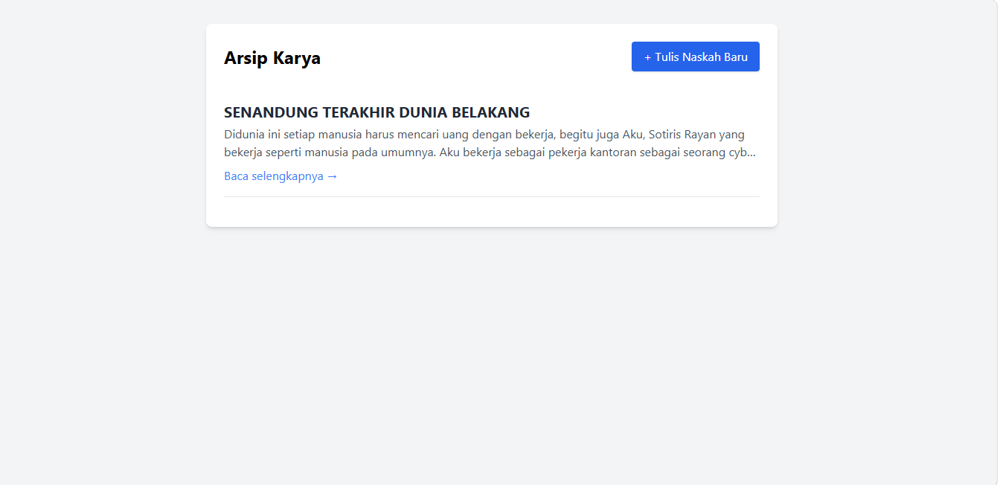
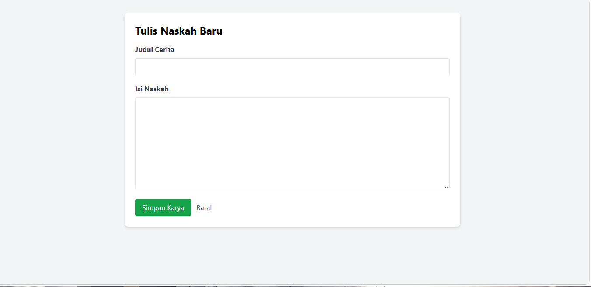

# Tugas Rutin 10 - Blog CRUD Laravel

Repositori ini berisi proyek aplikasi web sederhana berbasis **Laravel** untuk memenuhi Tugas Rutin 10. Aplikasi ini adalah sistem manajemen konten (Blog) yang memiliki fungsionalitas CRUD (*Create, Read, Update, Delete*) secara utuh.

## 🚀 Penjelasan Sistem
Aplikasi Blog CRUD ini memungkinkan pengguna untuk menulis, melihat daftar tulisan, mengubah konten tulisan yang sudah ada, dan menghapusnya. Proyek ini mengimplementasikan arsitektur **MVC (Model-View-Controller)** dengan tata letak antarmuka yang rapi dan interaktif menggunakan Tailwind CSS.

### Fitur Utama yang Diimplementasikan:
1. **Resource Route & Route Model Binding:** Menggunakan `Route::resource('posts', PostController::class)` untuk menghasilkan 7 rute standar CRUD hanya dalam satu baris kode. URL dirancang dinamis dengan *Route Model Binding* agar pencarian data (berdasarkan ID) berjalan otomatis.
2. **Blade Layout & Components:** Antarmuka dibangun menggunakan sistem kerangka induk (Master Layout) dengan direktif `@extends` dan `@yield`. Beberapa elemen UI juga dipecah menjadi komponen *Blade* independen (seperti `<x-alert>` dan `<x-card>`) agar kode lebih rapi dan dapat digunakan ulang (*reusable*).
3. **Form Validation & Old Input:** Setiap data yang dikirim melalui formulir divalidasi secara ketat di sisi *server*. Jika terjadi kesalahan input (misal: judul kosong), aplikasi akan mengembalikan pengguna ke halaman form dengan pesan *error* spesifik dan tetap mempertahankan ketikan sebelumnya (`old input`).
4. **Keamanan & Flash Message:** Seluruh formulir modifikasi data dilindungi oleh token `@csrf`. Aplikasi juga memberikan *feedback* visual berupa *Flash Message* (pesan kilat) setelah pengguna berhasil menyimpan, mengubah, atau menghapus naskah.

---

## 📸 Tangkapan Layar (Screenshot)

*Silakan ganti nama file gambar Anda menjadi `screenshot-index.png` dan `screenshot-form.png`, lalu letakkan di folder yang sama dengan file README ini.*

**Halaman Daftar Post (Index)**


**Halaman Tulis/Edit Naskah (Form)**


---

## ⚙️ Panduan Instalasi & Menjalankan Aplikasi

Jika Anda ingin menjalankan proyek ini secara lokal, ikuti langkah-langkah berikut:

1. **Kloning Repositori:**
   ```bash
   git clone https://github.com/USERNAME-ANDA/TugasWeb-P10-BlogCRUD.git
   cd TugasWeb-P10-BlogCRUD
   ```

2. **Instalasi Dependensi PHP:**
   Pastikan Anda sudah menginstal Composer, lalu jalankan:
   ```bash
   composer install
   ```

3. **Konfigurasi Environment:**
   Salin file konfigurasi bawaan dan sesuaikan kredensial *database* Anda.
   ```bash
   cp .env.example .env
   ```
   Buka file `.env` dan atur bagian database:
   ```env
   DB_CONNECTION=mysql
   DB_HOST=127.0.0.1
   DB_PORT=3306
   DB_DATABASE=nama_database_anda
   DB_USERNAME=root
   DB_PASSWORD=
   ```

4. **Generate App Key & Migrasi Database:**
   ```bash
   php artisan key:generate
   php artisan migrate
   ```

5. **Jalankan Server Lokal:**
   ```bash
   php artisan serve
   ```
   Buka *browser* dan akses aplikasi di `http://127.0.0.1:8000`.